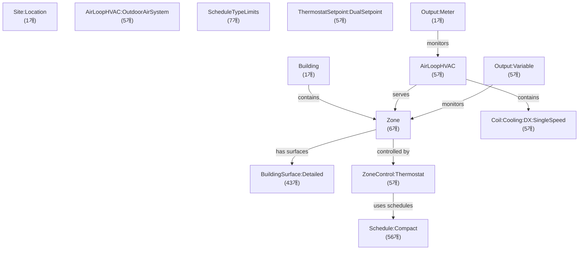
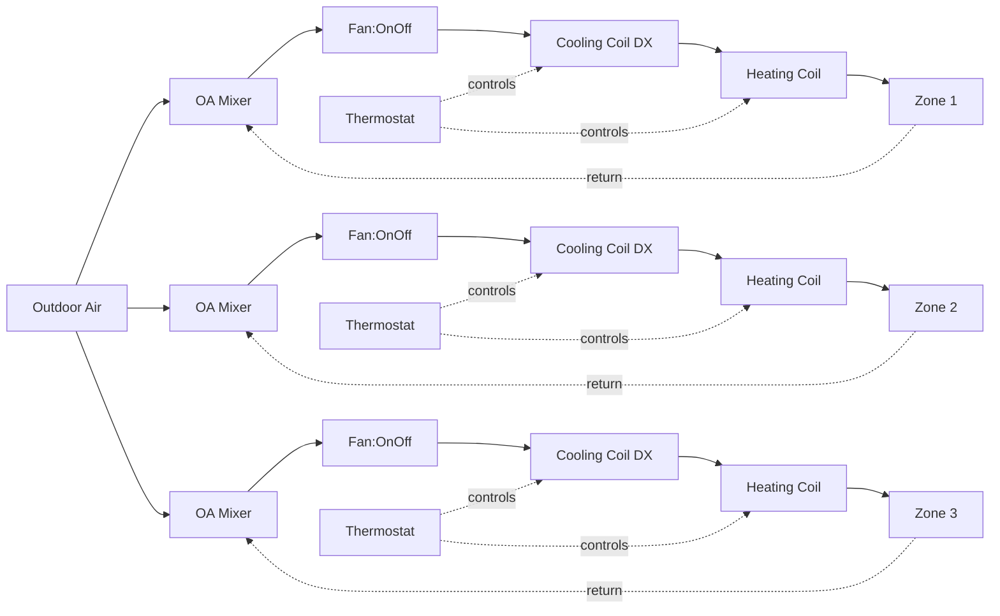
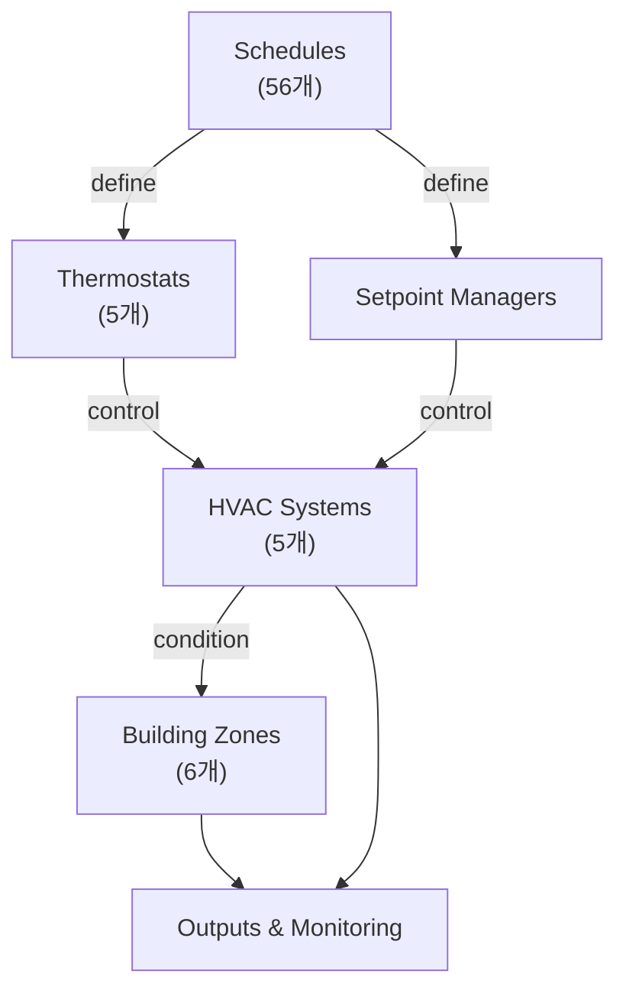

# Gwangju CAV 건물 상세 구조

## 건물 개요

- **건물명**: OfficeSmall
- **Zone 수**: 6개
- **Surface 수**: 43개 (벽, 바닥, 천장)
- **Window 수**: 23개
- **HVAC 시스템 수**: 5개 (PSZ-AC)
- **총 객체 타입**: 93개

## 1. 객체 간 전체 관계도

건물의 주요 구성요소와 그들의 관계를 보여줍니다.

## 2. 건물 구조

Zone과 각 Zone의 구성요소를 보여줍니다.

```mermaid
graph TB
    %% Building Structure Overview

    Building["OfficeSmall<br/>6개 Zone"]

    Z1["Zone: Attic"]
    Z1_Surf["Surfaces<br/>Walls, Floors, Roofs"]
    Z1_Win["Windows"]
    Z1_HVAC["HVAC Equipment"]
    Z1_Load["Internal Loads<br/>People, Lights, Equipment"]

    Building --> Z1
    Z1 --> Z1_Surf
    Z1 --> Z1_Win
    Z1 --> Z1_HVAC
    Z1 --> Z1_Load

    Z2["Zone: Core_ZN"]
    Z2_Surf["Surfaces<br/>Walls, Floors, Roofs"]
    Z2_Win["Windows"]
    Z2_HVAC["HVAC Equipment"]
    Z2_Load["Internal Loads<br/>People, Lights, Equipment"]

    Building --> Z2
    Z2 --> Z2_Surf
    Z2 --> Z2_Win
    Z2 --> Z2_HVAC
    Z2 --> Z2_Load

    Z3["Zone: Perimeter_ZN_1"]
    Z3_Surf["Surfaces<br/>Walls, Floors, Roofs"]
    Z3_Win["Windows"]
    Z3_HVAC["HVAC Equipment"]
    Z3_Load["Internal Loads<br/>People, Lights, Equipment"]

    Building --> Z3
    Z3 --> Z3_Surf
    Z3 --> Z3_Win
    Z3 --> Z3_HVAC
    Z3 --> Z3_Load

    Z4["Zone: Perimeter_ZN_2"]
    Z4_Surf["Surfaces<br/>Walls, Floors, Roofs"]
    Z4_Win["Windows"]
    Z4_HVAC["HVAC Equipment"]
    Z4_Load["Internal Loads<br/>People, Lights, Equipment"]

    Building --> Z4
    Z4 --> Z4_Surf
    Z4 --> Z4_Win
    Z4 --> Z4_HVAC
    Z4 --> Z4_Load

    Z5["Zone: Perimeter_ZN_3"]
    Z5_Surf["Surfaces<br/>Walls, Floors, Roofs"]
    Z5_Win["Windows"]
    Z5_HVAC["HVAC Equipment"]
    Z5_Load["Internal Loads<br/>People, Lights, Equipment"]

    Building --> Z5
    Z5 --> Z5_Surf
    Z5 --> Z5_Win
    Z5 --> Z5_HVAC
    Z5 --> Z5_Load

    Z6["Zone: Perimeter_ZN_4"]
    Z6_Surf["Surfaces<br/>Walls, Floors, Roofs"]
    Z6_Win["Windows"]
    Z6_HVAC["HVAC Equipment"]
    Z6_Load["Internal Loads<br/>People, Lights, Equipment"]

    Building --> Z6
    Z6 --> Z6_Surf
    Z6 --> Z6_Win
    Z6 --> Z6_HVAC
    Z6 --> Z6_Load

    %% Styling
    classDef buildingStyle fill:#FFE6E6,stroke:#333,stroke-width:3px
    classDef zoneStyle fill:#E6F3FF,stroke:#333,stroke-width:2px
    classDef componentStyle fill:#E6FFE6,stroke:#333,stroke-width:1px
```

## 3. HVAC 시스템 공기 흐름

외기(Outdoor Air)가 각 Zone으로 공급되는 과정을 보여줍니다.

## 4. 제어 시스템

건물의 제어 구조를 보여줍니다.

## 5. 주요 객체 목록

### HVAC 시스템

- AirLoopHVAC: 5개
- Fan:OnOff: 5개
- Coil:Cooling:DX:SingleSpeed: 5개
- Coil:Heating:Fuel: 5개

### Zone 구성

- Zone: 6개
  - Attic
  - Core_ZN
  - Perimeter_ZN_1
  - Perimeter_ZN_2
  - Perimeter_ZN_3
  - Perimeter_ZN_4

### 제어 시스템

- ZoneControl:Thermostat: 5개
- Schedule:Compact: 56개
- SetpointManager (전체): 25개

### 출력 변수

- Output:Variable: 5개
- Output:Meter: 1개

